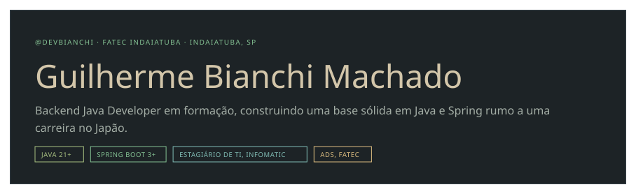
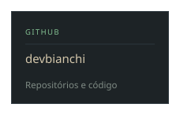
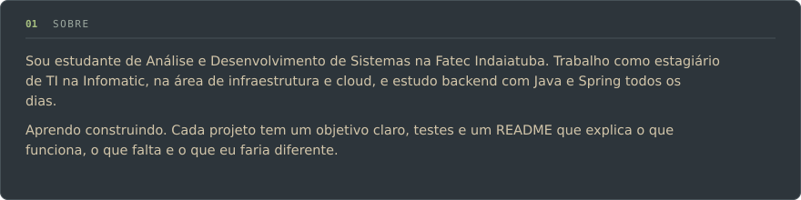
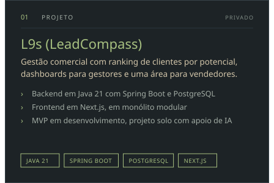
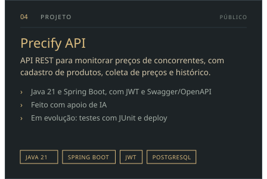
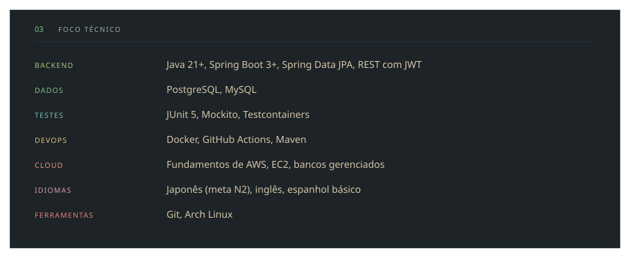
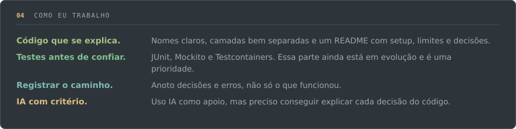
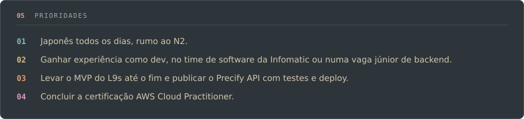

<!-- Os cards em cards/ são gerados por render_cards.py a partir de profile.json. Edite o JSON e rode o script. -->

<table>
<tr><td width="25%" valign="top"></td><td width="25%" valign="top"></td><td width="25%" valign="top"></td><td width="25%" valign="top"></td></tr>
</table>

<table>
<tr><td width="50%" valign="top"></td><td width="50%" valign="top"></td></tr><tr><td width="50%" valign="top"></td><td width="50%" valign="top"></td></tr>
</table>

